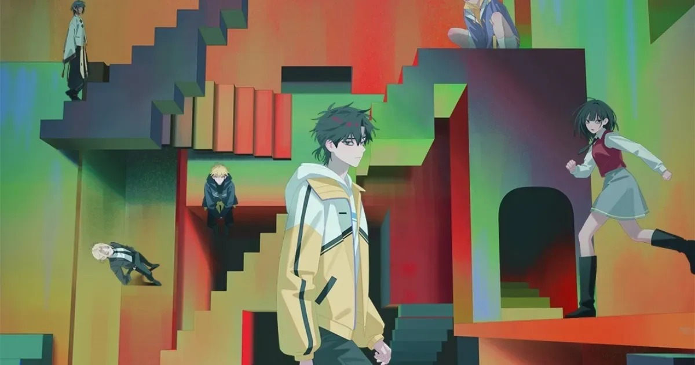
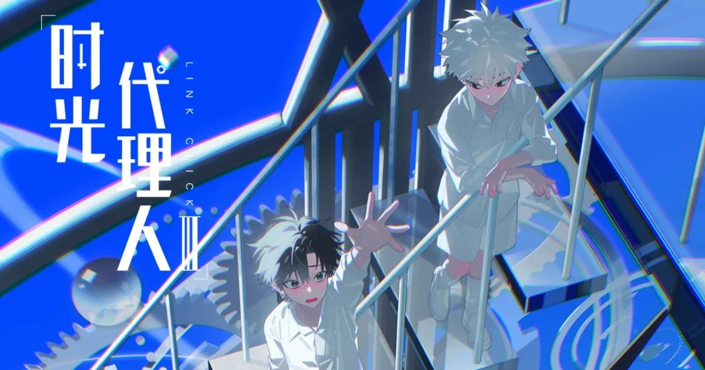
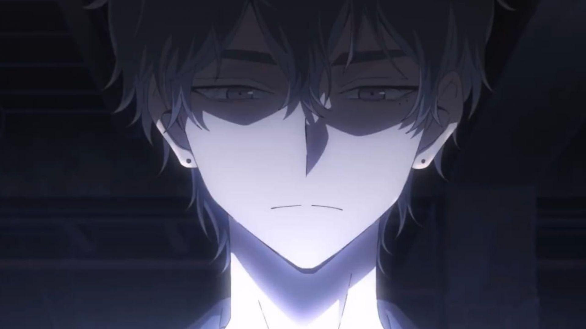
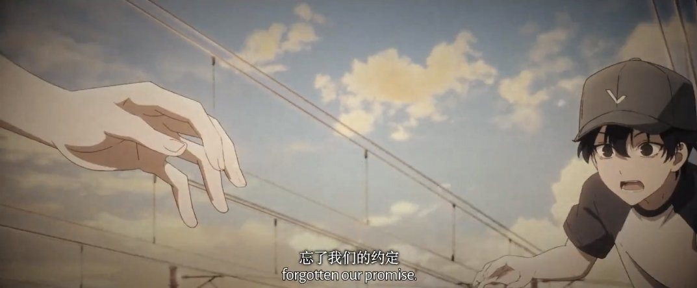

这一期选了《时光代理人》第三季 Part One 的四张宣传画面。沿着彩色楼梯、蓝色碎片和预告里的明暗变化，看看新一季如何用画面制造悬念。

## 楼梯与倒影

楼梯向几个方向延伸，画面边缘的人影随空间翻转。暖红与暗绿撞在一起，站在中央的程小时成了画面里最容易辨认的坐标。

## 蓝色碎片

一道道斜线把人物切进不同的区域。亮蓝、白色和玻璃反光连在一起，视线会沿着碎片的边缘来回移动。

## 从下方亮起的光

四周几乎都沉进暗处，只留一束冷光托住人物的脸。背景细节退开后，表情成了这一帧里最值得停留的地方。

## 伸向轨道另一端

轨道与电线把视线引向远处，左侧伸出的手和右侧的人物却隔着一大块天空。留白让这个瞬间有了距离感。

主视觉见 [SouNova 的第三季介绍](https://sounova.com/anime/link-click-season-3)，预告画面见 [Sportskeeda 的第三季预告报道](https://www.sportskeeda.com/anime/news-link-click-season-3-reveals-new-trailer-ahead-2026-premiere)及[轨道场景截图](https://x.com/meihanxues/status/1946223755606491459)。正片可在[哔哩哔哩番剧页](https://www.bilibili.com/bangumi/media/md26949780)查看。
